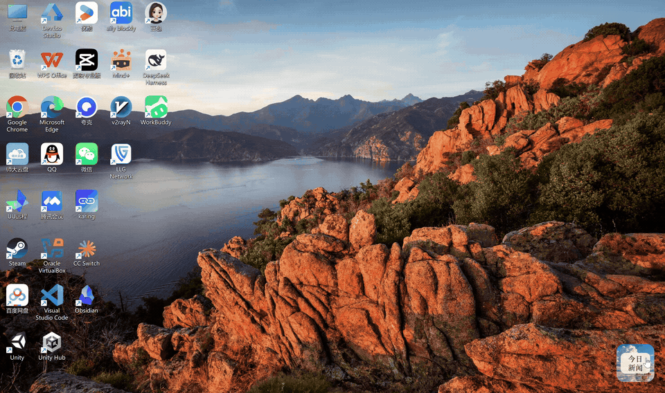

# 拾光简报 · Daily Glimpse

一个轻量的 Windows 桌面新闻小组件，精选 **AI、教育、心理**资讯，让每天的阅读更聚焦。

## 演示

[▶ 查看完整演示视频](assets/demo.mp4)

## 主要功能

- **每日精选**：每天 5 条中文新闻，默认 AI 2 条、教育 2 条、心理 1 条。
- **图文阅读**：新闻配图、内容摘要、分析与思考引导，并可打开原文来源。
- **桌面按钮**：点击展开或收起，可拖动位置、缩放窗口。
- **个性外观**：自定义背景、调节背景透明度，优先使用华文中宋。
- **自动更新**：运行时每天北京时间 08:00 更新，支持手动刷新与本地缓存。

## 使用

安装 Python 3.11 / 3.12 后，先双击 `install.bat`，再双击 `run.bat`。点击桌面的“今日新闻”按钮展开，右键可刷新或退出。

## 更换背景

将喜欢的图片保存为 **`assets/background.jpg`**，替换后重启小组件即可。展开窗口顶部的滑条可调整背景透明度，文字保持清晰。

更多安装、Conda 和 EXE 构建说明见 [使用指南](docs/USAGE.md)。分析为基于标题与摘要的本地阅读引导。
